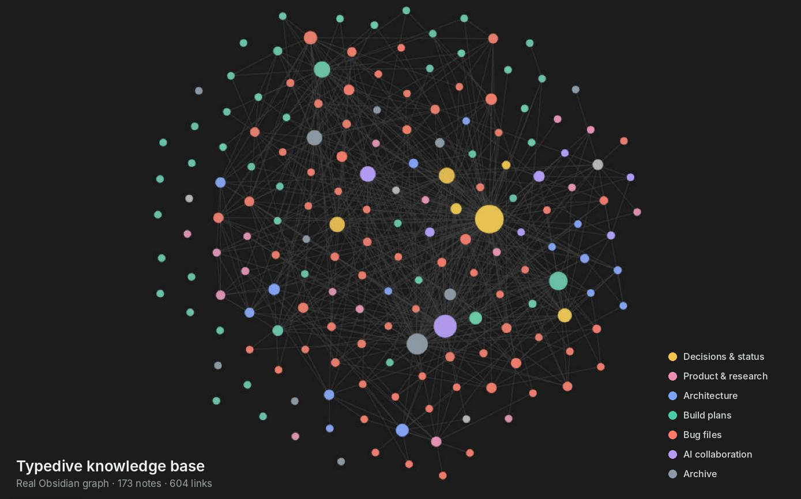
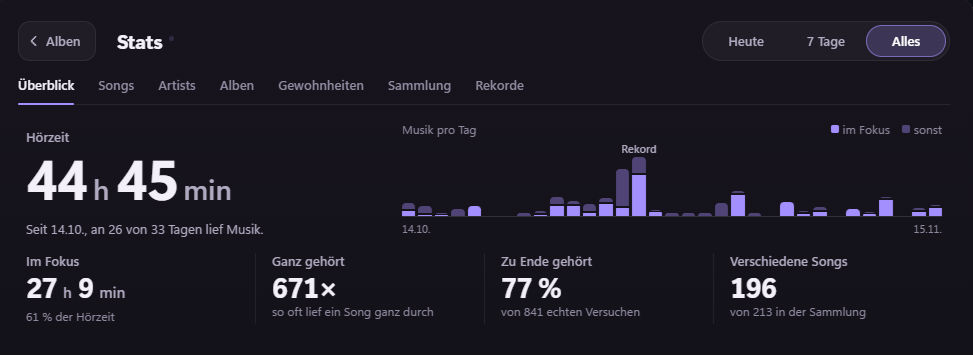

## Hi, I'm Daniel

In April 2025 I started building software with AI. Instead of learning to code I got really good at orchestration. For each task I pick the AI agents and setup that fit best and lead them to a working product.

Each project is my own idea. I set the direction and every decision goes through me. Claude Code does the programming and other AI agents review it. I test every change myself and nothing counts as done until I sign off.

My other big interest is how companies grow. I will start and scale my own company with AI. That goal and my love for compounding are why I want to study business.

### [Typedive](https://github.com/Daniel-Wojtaszewski/Typedive)

Typedive runs invisibly on Windows and fixes keyboard slips in real time. I tested it on 2,051 of my own typos. It fixed 1,079 correctly, got 14 wrong and missed 958. So when Typedive steps in it picks the right word 98.7% of the time.

The name comes from "type divergent". That's my own term for anyone who types differently. Two examples are people with dyslexia and anyone who thinks faster than they can type. They keep running into annoying mistakes like swapped letters. I'm building Typedive for them. If you're one of them, write to me at typedive@proton.me. I'd like you to try Typedive and tell me what it still misses.

### Right now

I'm digging into machine learning to work with AI even more efficiently. For Typedive the next step is [Fathom](https://github.com/Daniel-Wojtaszewski/Typedive#whats-next-fathom), a small decision model that will read the words before a mistake and pick the one you meant. After that I will enter Typedive in the BWKI 2027, Germany's national AI competition for school students. I'm also looking for early university courses in business and AI, an internship, startup events or hackathons.

*Typedive's knowledge base in Obsidian. It holds more than 300 decisions with the reason for each and a log of 74 mistakes my AI agents made. [How I build it](https://github.com/Daniel-Wojtaszewski/Typedive#how-i-build-it)*

### About me

I'm in 11th grade and study business administration and management at school. It's a two year program that ends with the Fachhochschulreife.

I'm inspired by people who achieved great things. They show me that almost anything is possible if you give your absolute best and fully commit to a vision.

You can find me on [LinkedIn](https://www.linkedin.com/in/daniel-wojtaszewski-036aa6449).

### Also building

#### Playtis

Playtis is a music app for Windows. I only rate the songs in my own library and it decides what comes next.

Higher rated songs come back more often, but never at a time you could guess. I can also mark favorites, boost single songs or block them for good.

There are two modes. Roam plays unrated songs first so new music gets a chance. Focus only plays my best rated ones while I work.

Everything runs from the keyboard in the background so I never have to leave what I'm working on. A small window shows the current song for a moment and then disappears.

#### SparX

SparX is my private tool for drafting posts and articles about decentralized AI. I tune it the way you would train a model and test every new version blind against the old one. It grew out of my fascination with Bittensor, an open and completely permissionless network where anyone can help build AI.
